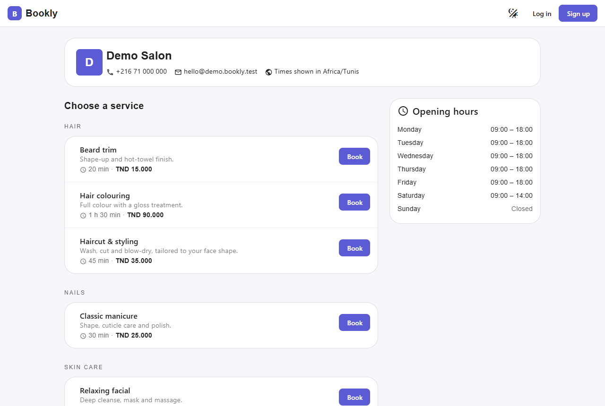
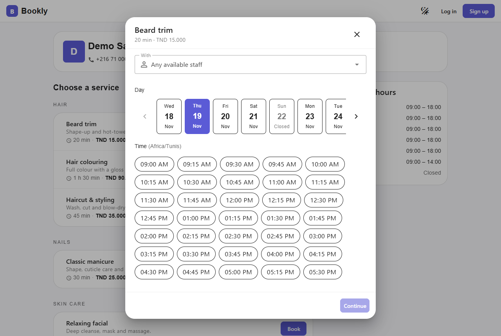
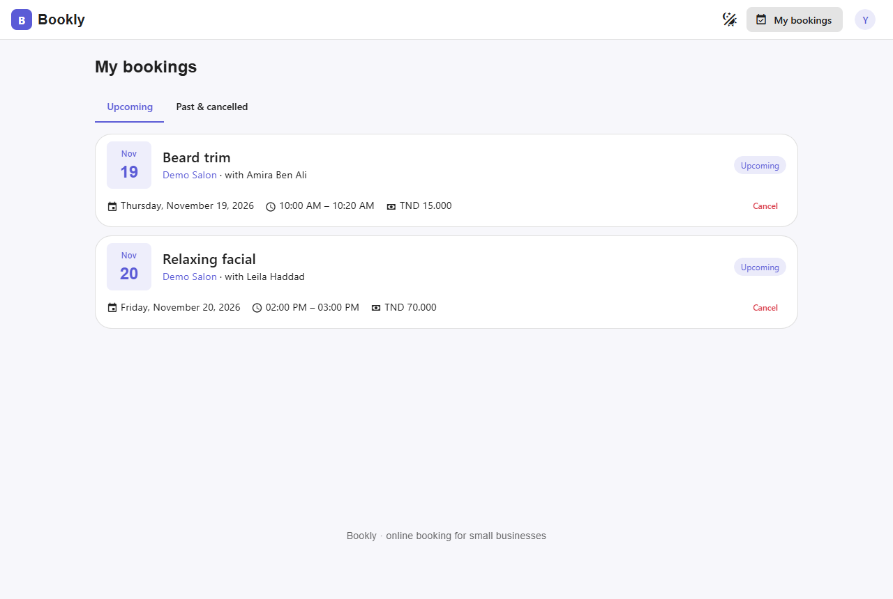
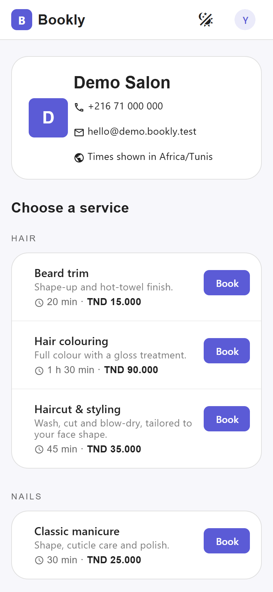

# Bookly: Front office

The customer-facing booking app for **Bookly**, a multi-tenant appointment SaaS.
Each business gets a public booking page at `/b/{slug}`. Customers create one account,
book with any business, and manage all their appointments in one place.

**Stack:** Vue 3 · TypeScript · Vite · Vuetify 3 · Pinia · Axios
**Related:** [API (Laravel)](https://github.com/ghofrane-soulmi/Bookly_backend) · [Back office (Vue)](https://github.com/ghofrane-soulmi/Bookly_frontend)

> **Live demo:** _add your Vercel URL here after deploying_. Open `/b/demo-salon`; customer login `customer@demo.bookly.test` / `123456789`.



## Features

- Marketing landing page: features, product tour, pricing, FAQ and calls to action for businesses and clients
- Public business page: services by category, prices in the business's currency, opening hours
- Real-time availability: free slots computed server-side from opening hours and each staff member's bookings
- Book with a specific staff member or "first available"; double-booking is prevented server-side (HTTP 409)
- Customer accounts (JWT, separate from staff auth), password reset by email
- "My bookings": upcoming and past appointments across every business, cancel online up to a cut-off
- Times always shown in the business's timezone; light and dark theme; mobile-friendly

| Booking | My bookings | Mobile |
|---|---|---|
|  |  |  |

## Run locally

```bash
cp .env.example .env   # set VITE_API_BASE_URL to your API (default http://localhost:8000/api)
npm install
npm run dev            # http://localhost:5174
```

Try it with the seeded demo: open `/b/demo-salon` and log in as `customer@demo.bookly.test` / `123456789`.

## Deploy

Deploys to Vercel as a static Vite app (`vercel.json` adds the SPA rewrite). Set `VITE_API_BASE_URL` and `VITE_DEMO_SLUG`.
